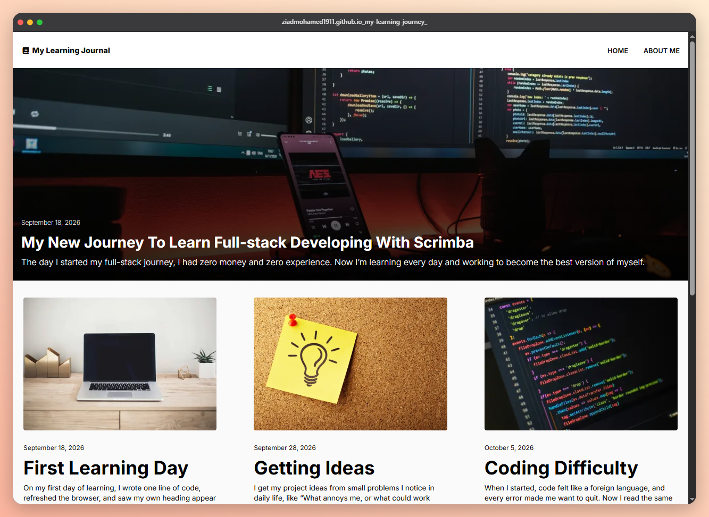

# My Learning Journal

A responsive blog-style website where I share what I'm learning on my journey from customer service to full-stack development. Built with plain HTML, CSS, and JavaScript.

**Live site:** https://ziadmohamed1911.github.io/my-learning-journey/

## Preview



## Features

- **Responsive layout** that works on mobile and desktop
- **Featured article hero** with a background image and dark gradient overlay, clickable as a link
- **Article cards grid** with 1 column on mobile and 3 columns on desktop
- **"View more" button** that loads articles in batches:
  - Shows 3 articles on mobile and 6 on desktop at first
  - Reveals 3 more on each click
  - Hides itself once every article is visible
- **About page** with a profile photo, intro, FAQ section, and recent posts
- **Auto-updating footer year** using JavaScript
- **Performance-minded:** WebP images, lazy-loaded card images, and `display=swap` for fonts

## Built With

- HTML5 (semantic elements such as `header`, `main`, `article`, `time`, `footer`)
- CSS3 (Flexbox, Grid, CSS variables, media queries)
- JavaScript (DOM manipulation, `matchMedia`)
- [Inter](https://fonts.google.com/specimen/Inter) from Google Fonts
- [Font Awesome](https://fontawesome.com/) for icons

## Project Structure

```
learning-journal/
├── index.html
├── style.css
├── base.css
├── index.js
├── images/
└── pages/
    ├── about/
    │   ├── about.html
    │   ├── about.css
    │   └── about.js
    └── main-article/
        └── main-article.html
```

## Getting Started

1. Clone the repository:
   ```bash
   git clone https://github.com/ziadmohamed1911/my-learning-journey
   ```
2. Open the folder in your code editor.
3. Open `index.html` in your browser, or use the Live Server extension in VS Code.

## How the "View more" Button Works

The script counts all the article cards and keeps a `visibleCount`. It starts at 3 on mobile or 6 on desktop (checked with `window.matchMedia`), and each click adds 3 more. Cards past that count get the `hidden` attribute, and the button hides when `visibleCount` reaches the total number of cards. Adding new articles to the HTML needs no JavaScript changes.

## What I Learned

- Building layouts with Flexbox and Grid
- Writing mobile-first CSS with media queries
- Selecting and updating elements with JavaScript
- Debugging CSS issues with browser DevTools
- Improving page speed with image compression, lazy loading, and font loading

## Future Improvements

- Add real article pages for each post
- Move shared styles (header, footer, cards) into one base stylesheet
- Add a dark mode toggle
- Add a contact section

## Author

**Ziad Mohamed**

- Cairo, Egypt
- GitHub: https://github.com/ziadmohamed1911
- LinkedIn: https://www.linkedin.com/in/ziad-mohamed-905a2129b/

## Acknowledgments

Started as a project in the [Scrimba](https://scrimba.com) Full-stack Developer Career Path.
